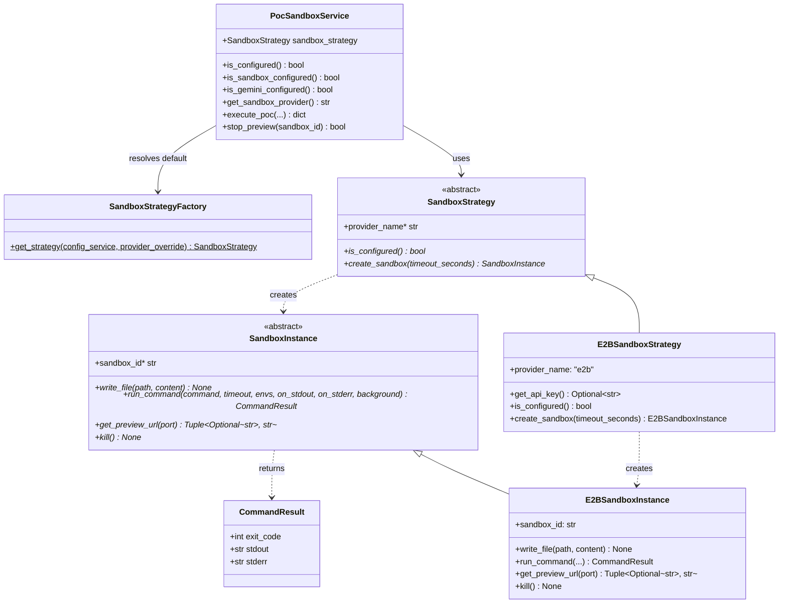

# ADR 007: Abstracting PoC Sandbox Execution Behind a Configurable Strategy Pattern

## Decision Summary
We are refactoring [`PocSandboxService`](../../app/llms/poc_sandbox_service.py) to decouple the PoC orchestration workflow from the underlying sandbox infrastructure by introducing a **Provider Strategy + Sandbox Instance** abstraction (`SandboxStrategy` and `SandboxInstance`) in a dedicated `app/llms/sandbox/` package, instantiated via `SandboxStrategyFactory` and configured under a `sandbox:` block in `config.yaml`.

## Context
- **Status quo:**
  - `PocSandboxService` directly couples PoC spike orchestration (generating seed files, installing/executing the Pi coding agent with Gemini, running build verification, starting the preview server, archiving output, and tracking active previews) with the `e2b` SDK (`e2b.Sandbox`).
  - Method names, status fields (`is_e2b_configured`, `e2b_configured`), and fallback simulation logic (`_simulate_execution`) are hardcoded around E2B.
- **Goals and requirements:**
  - Allow switching sandbox implementations (e.g., `e2b`, `minimal`, `opensandbox`) via `config.yaml` and environment variables (`SANDBOX_PROVIDER`) without modifying `PocSandboxService` orchestration logic.
  - Keep shared PoC orchestration, Pi agent execution, codebase zipping, and session tracking inside `PocSandboxService`.
  - Provide a clean break from E2B-specific method and API field names on `PocSandboxService` and `/api/poc/status`.
  - Remove the implicit simulated fallback (`_simulate_execution`) and return a clear, structured configuration error when the selected sandbox provider or Gemini API key is not configured.
  - Ship the concrete `E2BSandboxStrategy` implementation in this refactoring while establishing the contract for future providers.

## Options Considered

### 1. High-Level Execution Strategy (`execute_poc` per provider)
- **Description:** Each strategy implements the entire `execute_poc()` and `stop_preview()` workflow end-to-end, while `PocSandboxService` acts as a thin delegator.
- **Consequences:**
  - Positive: Complete freedom for a provider to alter how the coding agent is invoked.
  - Negative: Duplicates Pi agent setup, prompt formatting, build/test verification, zip extraction, and active session management across every provider implementation.

### 2. Single Low-Level Strategy Operating on Handles
- **Description:** A single `SandboxStrategy` class provides methods like `create()`, `write_file(sandbox, path, content)`, `run_command(sandbox, cmd, ...)`, `get_preview_url(sandbox, port)`, and `kill(sandbox)`.
- **Consequences:**
  - Positive: Keeps orchestration in `PocSandboxService`.
  - Negative: Forces callers to pass opaque sandbox handles back into the strategy on every operation and mixes provider-level configuration with per-instance lifecycle state.

### 3. Provider Strategy + Sandbox Instance Abstraction (Chosen Option)
- **Description:**
  - `SandboxStrategy` (provider-level): Checks provider configuration (`is_configured()`), exposes `provider_name`, and provisions instances via `create_sandbox(timeout_seconds) -> SandboxInstance`.
  - `SandboxInstance` (instance-level): Encapsulates a single running sandbox (`sandbox_id`, `write_file()`, `run_command() -> CommandResult`, `get_preview_url()`, `kill()`).
  - `SandboxStrategyFactory`: Resolves and instantiates the configured `SandboxStrategy` from `ConfigService`.
- **Consequences:**
  - Positive: Cleanly separates provider configuration/factory responsibilities from per-sandbox lifecycle and I/O; makes unit testing straightforward via mock `SandboxStrategy` / `SandboxInstance` objects; avoids duplicating Pi agent orchestration across providers.
  - Negative: Slight increase in number of classes (3 small modules in `app/llms/sandbox/`).

## Architecture & Design Details



### 1. Package Layout (`app/llms/sandbox/`)
- `app/llms/sandbox/__init__.py`: Exports `CommandResult`, `SandboxInstance`, `SandboxStrategy`, `E2BSandboxInstance`, `E2BSandboxStrategy`, `SandboxStrategyFactory`.
- `app/llms/sandbox/base.py`: Defines `CommandResult` dataclass, `SandboxInstance` ABC, and `SandboxStrategy` ABC.
- `app/llms/sandbox/e2b_strategy.py`: Implements `E2BSandboxStrategy` and `E2BSandboxInstance` wrapping the `e2b.Sandbox` SDK.
- `app/llms/sandbox/factory.py`: Implements `SandboxStrategyFactory.get_strategy(config_service)` matching the pattern of `ApiKeyRepositoryFactory`.

### 2. Configuration Schema (`app/config.yaml` & `ConfigService`)
```yaml
sandbox:
  provider: ${SANDBOX_PROVIDER}  # options: e2b (default), minimal, opensandbox, etc.
  e2b:
    api_key: ${E2B_API_KEY}
```
- `ConfigService.load_sandbox_provider() -> str`: Resolves `SANDBOX_PROVIDER` env var or `sandbox.provider` in `config.yaml`, defaulting to `"e2b"`.
- `ConfigService.load_sandbox_provider_config(provider: str) -> dict`: Returns `sandbox.<provider>` dictionary from `config.yaml`.
- `ConfigService.get_e2b_api_key() -> Optional[str]`: Reads `E2B_API_KEY`, `sandbox.e2b.api_key`, or legacy `e2b.api_key`.

### 3. Provider-Agnostic API & Error Handling
- `PocSandboxService`:
  - Replaces `is_e2b_configured()` / `get_e2b_api_key()` with `is_sandbox_configured()` and `get_sandbox_provider()`.
  - Accepts `sandbox_strategy: Optional[SandboxStrategy] = None` in `__init__` (resolving via `SandboxStrategyFactory` when omitted).
  - Removes `_simulate_execution()`. When `not self.is_configured()`, `execute_poc()` logs the missing configuration via `on_log` and returns a structured failure dictionary (`success: False`, `execution_mode: f"{provider}_error"`, `error: ...`, `summary: ...`).
- `/api/poc/status` (`app/api/api_poc.py`):
  - Returns `"sandbox_configured"`, `"sandbox_provider"`, and `"engine": f"{provider}_sandbox_pi"` instead of E2B-hardcoded fields.

